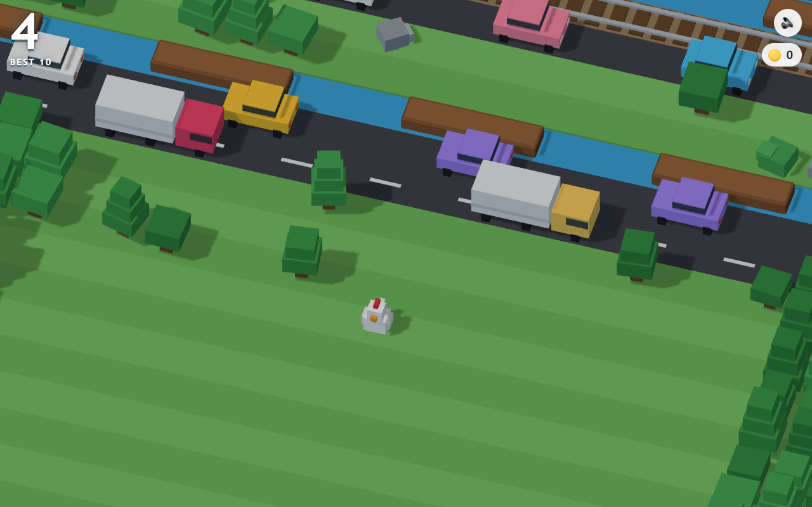

<div align="center">

# 🐔 CHICKEN CROSS

**An endless hopper in Three.js — roads, rivers and railways generated forever, a global top-ten board, and not one texture, model or audio file**

[](https://threejs.org)
[](https://developer.mozilla.org/en-US/docs/Web/JavaScript)
[](#%EF%B8%8F-tech-stack)
[](#-getting-started)
[](LICENSE)

**[▶ Play it](https://crossyhop.vercel.app)**

[Features](#-features) · [Getting Started](#-getting-started) · [The Scoreboard](#-the-scoreboard) · [How It Works](#-how-it-works) · [Tech Stack](#%EF%B8%8F-tech-stack)

</div>

---

<div align="center">



</div>

---

Every asset in this game is a box. The chicken is nine of them, the truck is fourteen, and the trees are three stacked cubes with a brown one underneath — which means the whole thing loads with no textures, no models, no sprite sheets and no audio files. The horn of a passing car, the bell before a train and the splash when you misjudge a log are all oscillators, written the moment they are heard.

That constraint is the interesting part, because it puts the entire budget into behaviour. Traffic is spaced by solving for a gap that stays constant across the wrap seam, so cars never bunch into a clot at the edge of the world. Logs carry you at their own speed and keep your offset, so hopping forward on a moving river is a different problem from hopping forward on grass. Trains do not simply appear: a bell rings, two signals blink, and one and a half seconds later something crosses the screen at 24 units a second.

The generator has opinions. Rows come in bands — a run of road, a river, a railway — and a rule that no more than five hazardous rows may stack before a strip of grass appears, because a board you cannot stand still on is not difficult, it is unfair. The first hazard you ever meet is always a road.

And if you dawdle, the camera starts moving without you, and an eagle takes you off the bottom of the screen.

## ✨ Features

- **Four kinds of row, generated forever** — grass with trees, rocks and coins; roads with cars and trucks; rivers with drifting logs and static lily pads; railways with express trains. Bands of one to three, never more than five hazards deep
- **Rivers you ride** — land on a log and it carries you, keeping the offset where you landed. Drift past the edge of the world and you are gone. Miss entirely and you sink, with a splash
- **Trains you can hear coming** — a bell, then two blinking signals, then 1.5 seconds of warning before something four carriages long crosses at speed
- **The eagle** — the camera creeps forward once you are moving, faster as your score climbs. Fall behind it and you are lifted off the screen
- **Four deaths, four animations** — flattened by a car, hit by a train, sunk in a river, or snatched by the eagle. Each one gets its own ending
- **A global top ten** — submit a name from the game-over card, or browse the board from the title screen. One row per name, best score kept
- **Coins**, a personal best in `localStorage`, screen shake, squash-and-stretch on every hop, and an input buffer so a fast second tap is not eaten
- **Keyboard, tap and swipe** — WASD or arrows on a desktop, tap to hop forward and swipe to steer on a phone, with a camera that widens on portrait screens instead of cropping the road
- **No build step** — seven ES modules, one HTML file and one serverless function. Serve the folder and it runs

## 🚀 Getting Started

**1. Clone**

```bash
git clone https://github.com/markksantos/crossyroad.git
cd crossyroad
```

**2. Serve it**

```bash
./serve.sh          # or: python3 -m http.server 8181
```

**3. Open it**

```
http://localhost:8181
```

Any static server works. It needs one only because ES modules will not load over `file://`. A plain static server has no `/api`, so the scoreboard reports itself offline and the game plays exactly as it otherwise would — the board is an addition, never a dependency. To develop against the live board:

```
http://localhost:8181/?api=https://crossyhop.vercel.app/api/scores
```

## 🎮 Controls

| Input | Action |
|---|---|
| `W` `A` `S` `D` / arrow keys | hop forward, left, back, right |
| tap | hop forward |
| swipe | hop in that direction |
| `space` | start, or retry |

## 🏆 The Scoreboard

A Redis sorted set behind a single serverless function, reached over Upstash's HTTPS REST API — no client library, no connection pool, no dependency in `package.json` because there is no `package.json`.

```
GET  /api/scores                      → { top: [ … ten entries … ] }
POST /api/scores {name, score, coins} → { rank, best, improved, top }
```

The board keeps **one row per name, holding that name's best score** (`ZADD … GT`). A player who scores 40, then 9, then 58 occupies exactly one row, reading 58 — so a single person cannot take all ten places, and `tester` and `TESTER` are the same person.

Everything that matters is checked on the server, because the client is a text field on the open internet:

| Guard | Rule |
|---|---|
| Name | uppercased, `[A-Z0-9 _-]`, 12 chars |
| Profanity | blocklist matched against the letters **and** a de-leetspeaked form, so `sh1t` and `f-u-c-k` do not walk past it |
| Score / coins | integers, 1–5000, anything else rejected |
| Rate limit | 15 submissions per minute per IP, via `INCR` with a 60-second expiry |
| Rendering | names go in through `textContent`, never `innerHTML` |

### Running your own

Any free Upstash Redis database will do. Point two environment variables at it and deploy:

```bash
vercel env add UPSTASH_REDIS_REST_URL production     # https://<your-db>.upstash.io
vercel env add UPSTASH_REDIS_REST_TOKEN production
vercel deploy --prod
```

`KV_REST_API_URL` / `KV_REST_API_TOKEN` work as aliases. Every key is namespaced under `cc:`, so the database is safe to share with other projects.

## 🔧 How It Works

```
constants.js   tile size, hop timing, the world's edges
       ↓
models.js      procedural boxes over cached geometry + materials
       ↓
world.js       band generator → rows → traffic, logs, trains, coins
       ↑              ↓
player.js      hop tweening, log riding, deaths   ← collision queries
       ↓
main.js        camera rig, game loop, input, HUD
       ↓
leaderboard.js → api/scores.js → Redis sorted set
```

### The rows

The world is a strip of rows along `-Z`, generated 26 ahead of the chicken and recycled 12 behind. Type is chosen in bands rather than per row, so a river reads as a river and not as noise, and a counter forces a strip of grass whenever five hazards have stacked up.

Traffic wraps at ±17 units. The spacing is solved rather than randomised — `count = floor(loop / (length + gap))`, positions at exact multiples of `loop / count` — because a random gap plus a modulo wrap puts two cars on top of each other at the seam, every lap, forever.

### The hop

A hop is a 140 ms tween with a sine arc, squash-and-stretch, and one buffered input so a fast second press lands instead of vanishing. If the destination row is water, the log under the target square is found *before* the hop starts and the target tracks it while you are in the air — which is why landing on a moving log feels like landing on a log, rather than landing where a log used to be.

### Two things worth knowing before editing it

- **The shadow camera has to be bigger than the view.** A directional light's shadow map clamps at its edge texel, so anything outside the frustum inherits whatever that texel holds — which rendered half the screen in a hard diagonal band of false shadow. It looks like a fog or material bug and it is neither.
- **Centre a tall card with `margin:auto`, not `place-items:center`.** Once the board fills to ten rows the game-over card outgrows a phone screen, and a grid that centres its overflow clips the top of it and puts *Play Again* out of reach with nothing to scroll. Flex plus `margin:auto` on the card scrolls properly in both directions.

### Verified, and not

Rows stay capped at 50 and the heap flat at ~26 MB across a 400-row run, at 60 fps with 378 draw calls — the rest of the ~2,900 objects are frustum-culled. Every death fires from its own cause; a log carries the player at exactly the log's velocity; the board caps at ten from twenty-four entries, sorted descending; a worse score never overwrites a better one; junk scores, empty names and leetspeak profanity are all refused; the rate limiter returns 429 on the sixteenth submission in a minute.

What none of that tells you is whether a run *feels* fair when the eagle is four rows behind you. Play it and decide.

## ⚙️ Performance

Geometries and materials are cached by dimension and colour, so a row costs allocations rather than GPU uploads, and rail sleepers and lane dashes — 61 and 16 identical blocks per row — collapse into one `InstancedMesh` each. Rows behind the camera are detached and their per-row GPU buffers released; everything shared stays in the cache for the next row that needs it.

The result holds 60 fps on a laptop with soft shadows on, and the whole game is about 2,600 lines across seven modules, one function, no images, no webfonts and no dependencies.

## 🛠️ Tech Stack

| What | How |
|------|-----|
| Rendering | Three.js r184, orthographic camera, PCF soft shadows |
| Language | Vanilla JavaScript, ES modules, importmap, no bundler |
| Models | Procedural `BoxGeometry`, cached and shared; `InstancedMesh` for repeats |
| Audio | Web Audio oscillators and filtered noise — no audio files |
| Scoreboard | Vercel serverless function → Upstash Redis over HTTPS REST |
| Storage | Redis sorted set for the board, `localStorage` for your own best |
| Type | System sans. No webfonts |
| Build | None |

## 📄 License

[MIT](LICENSE) © Mark Santos

*Crossy Road is a trademark of Hipster Whale. This is an independent tribute, built from scratch.*
